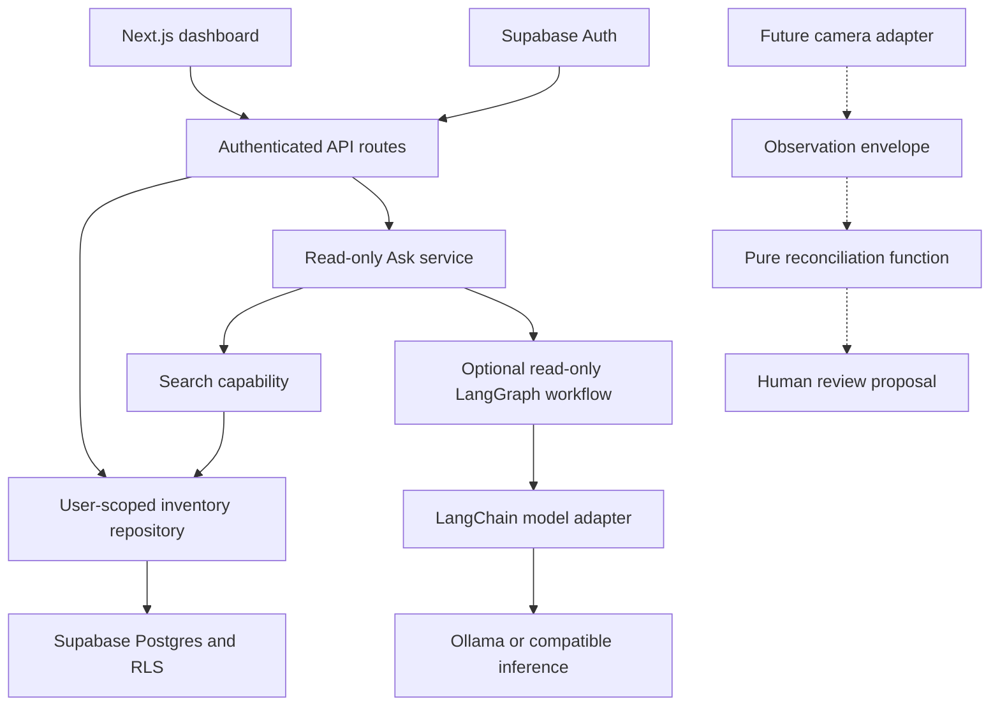

# Inventory

A private personal inventory MVP built with Next.js, Supabase Auth/Postgres, and a read-only AI interface. Track possessions, consumables, locations, tags, condition, and stock. Search your items and ask where they are.

The project uses permissively licensed open-source libraries. Google ADK and Vercel AI SDK are not dependencies. The default costs **zero model calls**: Ask returns matching inventory records. Optional inference runs through a small LangGraph workflow with LangChain model adapters, using Ollama or another OpenAI-compatible server. Claude remains an explicit opt-in adapter. See [Technology and cost decisions](docs/technology.md).

## Try it immediately

Requires Node.js 22+ and npm.

```sh
npm ci
npm run dev
```

Open **http://localhost:3000/demo**. The demo supports adding/editing/deleting items, creating locations, search, low-stock filtering, and read-only answers. It uses labeled sample data in memory; reload resets it. `/` shows setup instructions until Supabase is configured. The demo never bypasses authentication on production API routes.

## Architecture, top down



1. **UI:** collects manual input and presents inventory records and cited answers.
2. **API:** verifies the Supabase user, checks same-origin writes, validates JSON, and returns consistent errors.
3. **Repository:** performs queries with that user's session. Database RLS independently enforces ownership.
4. **Ask:** retrieves at most 20 matching records. Its provider receives only facts and a question—no database client, auth token, SQL tool, or writer.
5. **Reconciliation:** turns a future observation into a review proposal. It cannot mutate inventory.

Follow the code in this order:

| Responsibility             | Entry point                                      |
| -------------------------- | ------------------------------------------------ |
| App and account gate       | `src/app/page.tsx`                               |
| Dashboard and interactions | `src/components/dashboard.tsx`                   |
| Item validation and search | `src/lib/inventory.ts`                           |
| API behavior               | `src/lib/handlers.ts`                            |
| Verified request identity  | `src/lib/context.ts`                             |
| Database queries           | `src/lib/repository.ts`                          |
| Read-only answers          | `src/lib/ask.ts`                                 |
| Answer workflow            | `src/lib/answer-graph.ts`                        |
| Model adapter              | `src/lib/provider.ts`                            |
| Vision proposal boundary   | `src/lib/reconciliation.ts`                      |
| Tables and access policies | `supabase/migrations/202609130001_inventory.sql` |

The original design and implementation checklist are in `docs/superpowers/`.

## Connect real accounts and storage

### Option A: Hosted Supabase

1. Create a Supabase project.
2. Open its SQL editor and run `supabase/migrations/202609130001_inventory.sql` once on a new database. Or use the CLI workflow below.
3. Copy `.env.example` to `.env.local` and populate `NEXT_PUBLIC_SUPABASE_URL` and `NEXT_PUBLIC_SUPABASE_PUBLISHABLE_KEY` from the project's API settings. A legacy anon key also works in the publishable-key variable. **Do not use a service-role or secret key.**
4. In **Authentication → URL Configuration**, set Site URL to `http://localhost:3000` for development. Add `http://localhost:3000/auth/confirm` to allowed redirects. Use the same hostname consistently, including `127.0.0.1` if you choose it.
5. With email confirmation enabled, edit the **Confirm signup** email template to use this link:

```html
<a href="{{ .SiteURL }}/auth/confirm?token_hash={{ .TokenHash }}&type=email"
  >Confirm your email</a
>
```

6. Restart `npm run dev`, visit `/`, create an account, confirm the email, and sign in. Passwords require at least 8 characters in the app. Supabase controls its own password policy and Auth rate limits.

Confirmation redirects are fixed to the app root; arbitrary redirect URLs are not accepted. Password reset/social login are outside this MVP.

For repeatable CLI deployment, install the Supabase CLI using its [official instructions](https://supabase.com/docs/guides/local-development/cli/getting-started), then:

```sh
supabase login
supabase link --project-ref YOUR_PROJECT_REF
supabase db push
```

Do not apply this initial migration to an unrelated existing schema without reviewing its table names.

### Option B: Local Supabase

Install Docker and the Supabase CLI, then run from this directory:

```sh
supabase start
supabase status
```

The first start applies the migration. Put the local API URL and anon/publishable key printed by `supabase status` in `.env.local`. The included local configuration disables email confirmation for development only. Later migration changes can be applied with `supabase migration up --local`. `supabase db reset` recreates the local database and deletes its data, so use it only for a disposable development database.

```sh
npm run dev
```

Supabase Studio: http://localhost:54323. The regular app always authenticates through Supabase; it does not use the embedded test database.

## Environment variables

| Variable                               | Requirement               | Purpose                                    |
| -------------------------------------- | ------------------------- | ------------------------------------------ |
| `NEXT_PUBLIC_SUPABASE_URL`             | Required for real storage | Supabase project API URL                   |
| `NEXT_PUBLIC_SUPABASE_PUBLISHABLE_KEY` | Required for real storage | Public browser key; RLS protects records   |
| `AI_PROVIDER`                          | Default `search`          | `search`, `openai-compatible`, or `claude` |
| `AI_BASE_URL`                          | Compatible inference      | Server-only URL ending in `/v1`            |
| `AI_MODEL`                             | Compatible inference      | Exact installed/hosted model ID            |
| `AI_API_KEY`                           | Optional                  | Server-only compatible provider key        |
| `ANTHROPIC_API_KEY`                    | Only for Claude           | Server-only hosted API key                 |
| `ANTHROPIC_MODEL`                      | Only for Claude           | Exact model ID available to your account   |
| `SMOKE_EMAIL`, `SMOKE_PASSWORD`        | Integration test only     | Disposable confirmed account               |

Keep `.env.local` out of version control. No service-role credentials are needed.

## Optional open-source inference

Install [Ollama](https://ollama.com/) and start its local service. The documented model, [Qwen3-8B](https://huggingface.co/Qwen/Qwen3-8B), uses Apache-2.0; model licenses vary, so check the exact model you substitute.

```sh
ollama pull qwen3:8b
```

Set these values, keeping the Supabase variables:

```dotenv
AI_PROVIDER=openai-compatible
AI_BASE_URL=http://127.0.0.1:11434/v1
AI_MODEL=qwen3:8b
AI_API_KEY=
```

Restart Next.js. The server executes one read-only LangGraph node and calls Ollama's OpenAI-compatible endpoint through LangChain. There is no OpenAI account requirement. The `/no_think` instruction requests Qwen's non-thinking mode for short inventory answers. Hardware determines latency; if a response cannot finish within the timeout, the app returns ordinary search results.

Cost controls: one graph execution and one generation per Ask request, no tool loop, no retries, at most 1,200 output tokens, a 20-second timeout, up to 20 fact records within a 12,000-character record budget, descriptions capped at 500 characters, and large attribute objects omitted from model context. There is no automatic fallback to a paid model. Question size is limited to 1,000 characters. The model only summarizes retrieved matches; semantic retrieval and broad trip-planning are future work.

To opt into Claude, set `AI_PROVIDER=claude`, `ANTHROPIC_API_KEY`, and `ANTHROPIC_MODEL`. The same read-only contract applies. Provider errors or invalid/unknown citations produce a labeled search fallback. Model prose can still be wrong even with valid citations; the UI offers source records to verify facts.

## Schema and domain rules

- `items`: one durable possession per row (`quantity = 1`) or a consumable stock with nonnegative decimal quantity and a unit. Durable rows have no reorder threshold. For a spool or battery, use a durable row with flexible remaining-capacity attributes, or a consumable row measured in grams/units, depending on what you track.
- `locations`: reusable owner-specific named locations. A composite foreign key prevents an item from referring to another user's location.
- `inventory_observations`: append-only source events with confidence, event identity, observed/received times, base version, and proposed patch. Unique `(user_id, source, source_event_id)` prevents duplicate events. Owner-matching references prevent foreign item observations.
- Tags are normalized lowercase arrays. Attributes are bounded JSON objects. Status: `active`, `stored`, `lent`, `lost`, `disposed`. Condition: `new`, `good`, `fair`, `poor`, `unknown`.
- Updates increment `version` in Postgres. Edit/delete requests include the version they read; stale operations return `409`.
- Deletion is permanent and removes associated observations. Use `disposed` to retain an inventory entry and its history.
- Listing returns at most 200 records per search. The UI makes this limit visible; refine the query for larger inventories. Filters/statistics apply to the current result set. Search uses parameterized literal terms, with OR matching across names, notes, categories, locations, tags and attributes.

## API

Every production route requires the verified Supabase session cookie. Write requests also require an `Origin` matching the request URL and JSON content type. Request bodies are bounded to 16 KB.

| Method | Route                  | Input / result                                          |
| ------ | ---------------------- | ------------------------------------------------------- |
| GET    | `/api/items?q=charger` | `{ items, limit: 200 }`                                 |
| POST   | `/api/items`           | Item fields → `{ item }`, 201                           |
| PUT    | `/api/items/:id`       | Full editable item fields plus `version` → `{ item }`   |
| DELETE | `/api/items/:id`       | `{ version }` → `{ deleted: true }`                     |
| GET    | `/api/locations`       | `{ locations }`                                         |
| POST   | `/api/locations`       | `{ name }` → `{ location }`, 201                        |
| POST   | `/api/ask`             | `{ question }` → `{ answer, citations, mode, notice? }` |

Ownership fields are never accepted from callers. Error responses use `{ error }`: 400 invalid input, 401 missing auth, 403 forbidden/origin mismatch, 404 unknown/foreign item, 409 stale/conflicting data, 413 excessive body, 415 non-JSON body, 503 missing setup/storage unavailable. All personalized responses use `private, no-store`.

## Future camera integration

A vision adapter should identify a candidate item and produce an observation envelope. Example:

```json
{
  "user_id": "11111111-1111-4111-8111-111111111111",
  "item_id": "22222222-2222-4222-8222-222222222222",
  "source": "camera",
  "source_event_id": "camera-session-12:event-57",
  "confidence": 0.94,
  "observed_at": "2026-09-13T12:00:00Z",
  "base_version": 3,
  "proposed_patch": { "status": "stored" }
}
```

Call `reconcile(item, observation)`. It validates identity and proposed quantities, checks version and time, and returns `decision: "review"` with `confirmation_required`, `low_confidence`, `version_conflict`, or `stale_observation`. It never writes, even at confidence 1.0. A future authenticated ingestion route must derive `user_id` from the session, check destination ownership, deduplicate, persist the event, and expose explicit human confirmation through a version-checked writer. There is no ingestion or confirmation route yet. Observations are evidence; item fields are the current manually confirmed state.

## Tests and verification

```sh
npm run check       # lint + TypeScript + core/HTTP/provider/Postgres tests
npm run build       # production compilation and route generation
npm run format:check
```

The database suite runs the real migration in **PGlite**, an embedded PostgreSQL engine, with two users, `auth.uid()` and authenticated/anonymous role fixtures. It executes RLS, quantity constraints, owner-matching foreign keys, stale updates, RPC search, append-only observation access and deduplication. It does not replace testing Supabase Auth/PostgREST in a configured project.

For a real integration smoke test, create a disposable confirmed Supabase user and set `SMOKE_EMAIL`/`SMOKE_PASSWORD` in `.env.local`:

```sh
npm run test:supabase
```

This script signs in through real Auth, creates its own temporary location/item, checks RPC search and stale update behavior, then deletes only those test records and signs out. It does not use admin credentials or print credentials. See `docs/verification.md` for checks performed during delivery and external dependencies still needing configuration.

## Deploy to Vercel

1. Put **this directory** in a Git repository and import it into Vercel. If committing the containing workspace instead, set Vercel's Root Directory to the path ending in `outputs/Inventory`.
2. Choose Next.js and Node 22.x. Install: `npm ci`; build: `npm run build`. No custom output directory is needed.
3. Set the two public Supabase variables in the intended Vercel environments. Keep `AI_PROVIDER=search` initially.
4. Apply the migration to that environment's Supabase database before first use.
5. Set Supabase Site URL to the deployed HTTPS URL and allow its `/auth/confirm` URL. Configure preview redirect URLs intentionally; use a separate Supabase development project for previews.
6. Deploy. Test account creation/confirmation, login/logout, CRUD, search, and two-user isolation. CI runs lint/typecheck/tests/build on pushes and pull requests.
7. To enable inference on Vercel, use a secured, remotely reachable compatible endpoint or the opt-in Claude adapter. **Vercel cannot reach Ollama running on your laptop at localhost.** Keep API keys server-only. The Ask route declares a 30-second maximum, with a 20-second provider timeout.

The app can also run on a regular Node server with `npm run build` and `npm start`; it has no required Vercel-only APIs. When exposing a paid model publicly, add shared per-user rate limits/quotas and provider spend limits first. This MVP bounds each request but does not impose a shared daily spending quota. Hosted Supabase, Vercel and hosted model services have their own service plans and terms; permissive source licenses do not imply free infrastructure.
