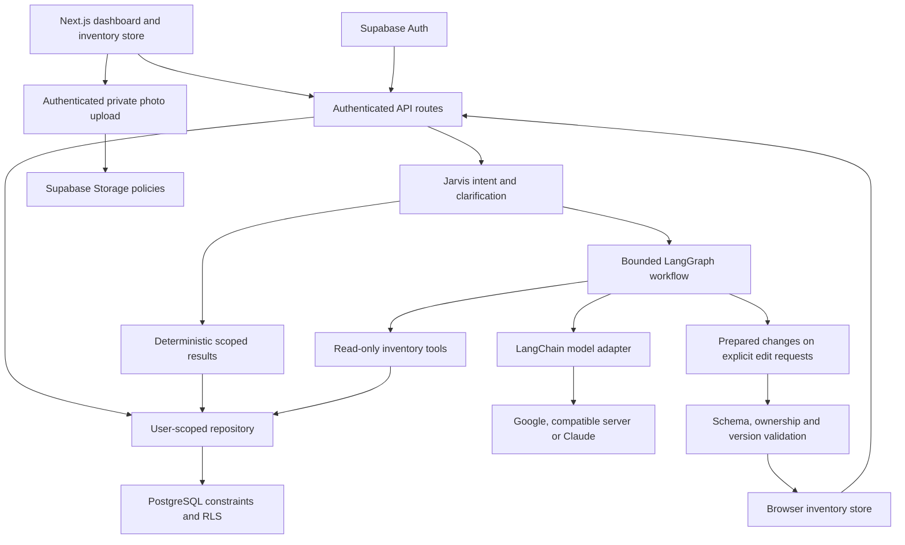

# Inventory

A personal inventory app built with Next.js and Supabase. Track items and consumable stock, organize them into Spaces, optional Rooms and nested Containers, and search or ask Jarvis about your records.

New items and locations stay unsaved until you choose **Add**. Saved accounts support private item photos; sample data stays in memory and resets on reload.

## Architecture

The application separates interaction state, request authorization, domain validation, database access and model orchestration. The model is not given a database client, SQL tool or authentication token.



1. **UI and session boundary.** [InventoryApp](src/components/inventory-app.tsx) chooses between labeled in-memory samples and a signed-in account. Saved inventory is loaded before the workspace opens; failures stay visible rather than silently switching to samples. The [dashboard](src/components/liquid-dashboard.tsx) owns navigation, drafts, item details and the inline conversation. The [inventory store](src/components/use-inventory-store.ts) coordinates writes and ignores work that no longer belongs to the active workspace.
2. **API and identity.** [Request context](src/lib/context.ts) verifies the Supabase user with `auth.getUser()`. [Handlers](src/lib/handlers.ts) validate inputs and delegate through repository contracts. Mutating requests require a matching Origin; personalized JSON responses are private and uncached. The client cannot choose a record's owner.
3. **Repository and database.** The [repository](src/lib/repository.ts) uses that user's session and filters by owner. PostgreSQL independently enforces RLS, owner-matching relationships, hierarchy constraints and versioned mutations. RPCs keep creation retries and conflicting edits inside transactions rather than relying on browser state for correctness.
4. **Jarvis reads and reasoning.** [Ask](src/lib/ask.ts) resolves exact inventory scopes separately from model-generated prose. Packing clarification is deterministic. When inference is enabled, the [answer graph](src/lib/answer-graph.ts) exposes bounded search/catalogue tools, validates structured output and rejects unknown citation IDs. One request shares a complete account snapshot; individual model pages remain bounded.
5. **Explicit writes through Jarvis.** Only an explicit add/edit request enables change preparation. The model returns proposals, not saved records. The browser validates the batch and applies it through the existing store and authenticated mutation routes. A partial failure reports completed records and unapplied changes; there is no automatic retry of a partially applied batch. Packing suggestions and revisions never apply inventory changes.
6. **Private media.** Uploads go to owner-specific Storage paths. The item stores an object path; an authenticated reader checks ownership and issues a short-lived signed URL. Media storage and item-version checks remain separate so an unsuccessful attachment does not overwrite the previously saved photo.

### Design choices and tradeoffs

| Choice                                                     | Reason and consequence                                                                                                                                                                  |
| ---------------------------------------------------------- | --------------------------------------------------------------------------------------------------------------------------------------------------------------------------------------- |
| Next.js UI and API in one TypeScript app                   | Shared validation and a single deployment unit; still deployable as a regular Node server rather than requiring Vercel-specific services.                                               |
| PostgreSQL constraints and RLS alongside API checks        | The database protects ownership and invariants even if a client bypasses the UI. Version conflicts remain explicit instead of silently overwriting another session.                     |
| Spaces/Rooms are locations; Containers are inventory items | Physical locations have stable identities, while a Container can hold recursive contents and be edited like a possession. Paths are derived rather than copied to every descendant.     |
| Deterministic scope queries, optional model reasoning      | “Everything in Home” is a paginated data operation, not a claim that a model's short citation list is exhaustive. Basic use needs no model service.                                     |
| Bounded LangGraph tool loop                                | Retrieval can expand beyond literal question words without granting arbitrary execution. The final turn is reserved for answering; incomplete or invalid inference falls back honestly. |
| No embeddings service or vector database                   | Fewer infrastructure dependencies and transparent keyword/category retrieval, with less semantic flexibility when inference is disabled.                                                |
| Local or hosted inference                                  | Local inference keeps model traffic on the machine but requires suitable hardware; hosted inference sends selected facts/history outside the app and may incur usage charges.           |

Direct dependencies and their licenses are recorded in [dependency-licenses.json](dependency-licenses.json); resolved versions are pinned in `package-lock.json`. Model weights are not bundled, and their license is separate from the inference runtime. See [technology and cost decisions](docs/technology.md) for supporting rationale.

## Run locally

Requires Node.js 22+ and npm (`.nvmrc` selects Node 22).

```sh
npm ci
npm run dev
```

Open [127.0.0.1:3000](http://127.0.0.1:3000). No Supabase or model credentials are needed to explore the sample inventory. Without a signed-in account, changes are session-only. Saved-inventory loading failures offer a retry; they do not replace your records with samples.

## Set up saved inventory

1. Create or select a Supabase project. Apply the SQL files in [supabase/migrations](supabase/migrations/) in filename order. For an existing Inventory database, review its migration history and apply only pending files. Do not apply these migrations to an unrelated schema.
2. Copy [.env.example](.env.example) to `.env.local` if that file does not already exist. Set:

   ```dotenv
   NEXT_PUBLIC_SUPABASE_URL=your-project-api-url
   NEXT_PUBLIC_SUPABASE_PUBLISHABLE_KEY=your-public-publishable-key
   ```

   Use the public publishable key (or legacy anon key), never a service-role or secret key. Keep `.env.local` out of version control. The template selects Claude; configure its key as described below, or set `AI_PROVIDER=search` to explicitly disable inference.

3. In Supabase Auth, set the Site URL to `http://127.0.0.1:3000` and allow `http://127.0.0.1:3000/auth/confirm`. Use the same hostname consistently. If email confirmation is enabled, set the confirmation email link to:

   ```html
   <a href="{{ .SiteURL }}/auth/confirm?token_hash={{ .TokenHash }}&type=email">
     Confirm your email
   </a>
   ```

4. Restart the dev server, then choose **Sign in → Create an account**. Confirm your email if required. New accounts start empty: add a Space, then an item, Room or Container. Signing out returns to sample data.

**Migration prerequisite:** this version requires [202610130001_rooms_creation.sql](supabase/migrations/202610130001_rooms_creation.sql) after all earlier migrations. It adds Room hierarchy and safe creation retries. A code push does not apply database migrations. Back up an existing database and review pending changes before rollout; see the [verification plan](docs/verification.md).

For local Supabase, install Docker and the Supabase CLI, run `supabase start`, and use the local API URL and public key from `supabase status`. Later migrations use `supabase migration up --local`. The included development configuration disables email confirmation. Do not use `supabase db reset` on data you need to keep.

For a CLI-managed hosted project, authenticate with the Supabase CLI, link the intended project and review the pending migration plan before `supabase db push`. This is a schema-changing operation, not part of starting the local app. Supabase Studio for the included local setup is at `http://localhost:54323`. Password reset and social login are not implemented; email confirmation redirects return to the app root rather than accepting arbitrary destinations.

## Data model and invariants

The schema lives in [versioned SQL migrations](supabase/migrations/); [Zod domain contracts](src/lib/inventory.ts) validate the application inputs. Database constraints are the persistence boundary, not just a mirror of form validation.

| Table                         | Responsibility                                                                                                                               |
| ----------------------------- | -------------------------------------------------------------------------------------------------------------------------------------------- |
| `items`                       | Durable possessions, consumable stock and Containers; category, tags, status, condition, JSON attributes, placement, timestamps and version. |
| `locations`                   | Root Spaces and optional one-level child Rooms, with owner, stable ID, parent ID and version.                                                |
| `inventory_creation_requests` | Owner/entity-scoped consumed Add UUIDs, retained after entity deletion so a delayed retry cannot resurrect it.                               |
| `inventory_activity`          | Trigger-generated audit events for item creation, edits, moves and deletion, including the `user` or `jarvis` action channel.                |
| `inventory_dashboard_visits`  | A per-user marker for the last explicitly acknowledged dashboard briefing.                                                                   |
| `inventory_observations`      | Append-only proposed observations with event identity, confidence, observed time and base version; separate from confirmed item state.       |

### Quantities and placement

- `durable` items and `container` records have `quantity = 1` and no reorder threshold. `consumable` stock accepts nonnegative decimal quantities with a unit and optional low-stock threshold. Remaining capacity can be represented as attributes or consumable stock rather than turning a durable possession into an arbitrary count.
- An item cannot have both `location_id` and `parent_container_id`. A root Container must have a location; a nested Container or item belongs to one parent Container. Ordinary items may be unplaced at the API level; creation forms require an explicit destination.
- Effective location, ancestor IDs and full paths are derived from the root. Changing an existing Container's placement through the Location editor changes its descendants' inherited paths without rewriting each child. There is no universal drag-and-drop or manual reorder workflow.
- Container cycles, foreign-owner parents, non-container parents, conversion of an occupied Container and deletion of non-empty Containers are rejected. Owner-matching foreign keys protect relationships independently of client validation.
- A Space has no parent; a Room belongs to exactly one root Space. Names are unique among siblings, allowing `Home → Bedroom` and `Cabin → Bedroom`. Existing root locations are not converted to Rooms by guessing from names. A Space with Rooms cannot be deleted until those Rooms are removed.
- Location deletion uses a transactional RPC: direct contents are reassigned to an allowed destination, or the operation fails instead of stranding Container roots. Item placement remains editable through the existing Location field.

### Consistency and audit

- Updates increment the item's `version` in PostgreSQL. Item edit/delete requests supply the version they read; stale writes return `409`. Location versions support consistent hierarchy snapshots; the location rename HTTP contract does not accept an expected-version field.
- Explicit creation uses `X-Inventory-Request-Id`, one UUID per draft. Retrying the same successful request returns the same record; reusing its key for different data or a deleted record is rejected. A confirmed insert is not reported as failed merely because a subsequent hierarchy read failed. After an ambiguous network failure, retain the draft/key and reload before retrying.
- Status is `active`, `stored`, `lent` or `disposed`; condition is `new`, `good`, `fair`, `poor` or `unknown`. Tags are normalized lowercase unique arrays; JSON attributes are size-bounded.
- Deletion is permanent and removes the item's observations. Use `disposed` to retain the possession's record. Consumed creation keys remain until the owning account is removed.
- Activity is written by triggers, not fabricated from the current item list. “Since your last visit” requires a durable acknowledged marker; a first visit uses recorded activity from the past 30 days. `X-Inventory-Actor: jarvis` records an action channel, not a separate identity or authorization grant.
- Observation uniqueness on `(user_id, source, source_event_id)` prevents duplicate events. The observation table is evidence, not an alternate route for silently updating inventory.

## API contracts

Saved-inventory endpoints verify the Supabase session. JSON mutations require a matching Origin and `Content-Type: application/json`. Ownership is derived from the session, never accepted from a body. Personalized responses use `Cache-Control: private, no-store` and vary on the session cookie.

| Method | Route                     | Request and response                                                                                                                                                                                                           |
| ------ | ------------------------- | ------------------------------------------------------------------------------------------------------------------------------------------------------------------------------------------------------------------------------ |
| GET    | `/api/items?q=charger`    | `{ items, limit }`. Non-empty search is capped at 200; an empty query returns the complete hierarchy snapshot with `limit: null`.                                                                                              |
| POST   | `/api/items`              | Validated item fields → `{ item }`, `201`. Optional `X-Inventory-Request-Id` supports idempotent creation.                                                                                                                     |
| PUT    | `/api/items/:id`          | Full editable item fields plus `version` → `{ item }`. This is not a partial patch.                                                                                                                                            |
| DELETE | `/api/items/:id`          | `{ version }` → `{ deleted: true }`; refuses stale or invalid deletion.                                                                                                                                                        |
| GET    | `/api/locations`          | `{ locations }`, including Room parent IDs and location versions.                                                                                                                                                              |
| POST   | `/api/locations`          | `{ name, parent_location_id? }` → `{ location }`, `201`; omit/null parent for a Space. Supports the creation-request header.                                                                                                   |
| PATCH  | `/api/locations`          | `{ id, name }` → `{ location }`. Renames an existing location without changing its hierarchy.                                                                                                                                  |
| DELETE | `/api/locations`          | `{ id, destinationId }` → `{ deleted: true }`; destination may be null only when the domain rules allow it.                                                                                                                    |
| POST   | `/api/ask`                | `{ question, history? }` → `{ answer, citations, mode, notice?, changes?, inventoryResult?, scopeChoices?, clarification?, contextNotice? }`.                                                                                  |
| GET    | `/api/inventory/contents` | Query `type=location\|container\|all`, scope `id` when needed, optional `offset` and `revision` → a structured scope page.                                                                                                     |
| GET    | `/api/dashboard`          | Per-user activity groups, summary and a grounded suggestion.                                                                                                                                                                   |
| POST   | `/api/dashboard/visit`    | `{ asOf }` → `{ acknowledged: true }`; acknowledge only the exact successfully rendered briefing.                                                                                                                              |
| GET    | `/api/items/:id/photo`    | Authenticated ownership check → redirect to a temporary signed Storage URL.                                                                                                                                                    |
| POST   | `/api/ask/local`          | Same-origin, session-only demo `{ question, history?, items, locations? }`; uses the supplied snapshot, never a saved account. Production accepts at most 200 items, 100 locations and 128 KB, with per-instance usage limits. |

CRUD JSON bodies are bounded to 16,000 bytes. Ask accepts up to 128,000 bytes; the development snapshot endpoint accepts up to 8,000,000 bytes, 5,000 records and 1,000 locations. Questions are limited to 1,000 characters and history to six bounded exchanges. Limits apply to actual streamed bytes, not just the claimed Content-Length.

Errors use `{ error }`: `400` invalid input, `401` missing authentication, `403` forbidden/origin mismatch, `404` unavailable record/scope, `405` unsupported method, `409` stale/conflicting state, `413` oversized body, `415` non-JSON input, `503` missing setup/storage unavailable, and `500` an unexpected failure. Unknown/foreign record handling does not grant access to another owner's data.

The [handlers](src/lib/handlers.ts), [HTTP boundary](src/lib/http.ts), [repository](src/lib/repository.ts) and [request context](src/lib/context.ts) are the source contracts. Supporting tests exercise both HTTP failures and database policies.

## Use Jarvis

Jarvis lives in the Dashboard conversation. Try:

- “Show everything in Home” — full location scope, including Rooms and nested Containers, with counts and paginated results.
- “Pack me for camping” — focused questions about missing trip details; answer what you know or say “basic list” or “assume” to proceed provisionally.
- “What camera accessories do I have?” — matching records with links to item details.

### Retrieval, clarification and grounding

Exact scope questions use structured inventory results independently of inference. A Space includes direct records, its Rooms and recursive Container contents; a Container includes its descendants. Duplicate names require selection by full path. Each page reports its resolved scope/path, `total`, `offset`, `limit`, `nextOffset`, `complete` and a `revision` fingerprint, with at most 100 records within a 240 KB UTF-8 record budget. The UI accumulates pages without duplicate IDs. Continuing against changed inventory/path state returns `409`, prompting a restart rather than mixing snapshots. A page's `complete` flag is not a substitute for counting all accumulated pages.

For open-ended questions, each saved request shares a complete account snapshot across bounded retrieval and catalogue tools. The model sees a compact category/catalogue overview and can search for full evidence beyond the initial matches. Tool result pages contain at most 20 full facts within 12,000 characters; they expose continuation offsets. Descriptions remain available for validated edits, while oversized attributes are omitted from model facts. A compact overview is a discovery aid, not proof that the first page is the entire inventory.

Materially incomplete packing requests first receive one focused bundle of up to three questions, without a model call: destination/expected conditions, length and camping style when relevant. User-supplied answers remain attached to the trip; a new trip does not inherit the previous destination's weather. Partial, unknown, “basic list” and “assume” replies proceed with labeled provisional assumptions. Exact inventory scopes and explicit edits bypass this trip questionnaire. Context is bounded to the recent session conversation, not stored as a durable trip plan.

Packing retrieval separates available owned records from general supplies to check. Zero stock, lent and disposed items are not packable. Missing personal-essential cards can receive a separately labeled, bounded review section using retrieved record evidence; these are not automatically packed, medical instructions or inferred purchases. Explicit packing exclusions remain read-only revisions. Product suitability, weather protection and accessory compatibility are not guaranteed by a matching record name.

The graph allows at most four model invocations, up to four tool calls in each of the first three rounds, zero automatic model retries, 1,200 output tokens per generation and a 25-second graph deadline. The fourth invocation disables tools and requests a final grounded answer instead of offering a search that cannot be executed within the budget. The compatible and Claude adapters also have a 20-second call timeout. Invalid arguments receive bounded corrective feedback; invalid JSON/schema, unknown citations, provider failures or exhausted budgets produce an honest fallback rather than a successful AI label. Optional internal diagnostics contain reason codes, counts and timings—not prompts, inventory text or raw provider errors.

### Explicit inventory changes

With inference enabled, requests such as “Add a tent in College, category Camping”, “Rename my backpack to Hiking backpack” and “Tag my camera with travel” can prepare changes. Editable fields include name, description, category, tags, quantity/unit, status, condition and placement in an existing location or uniquely resolved Container. There is no delete or ownership-change tool.

At most five changes are prepared per request. The UI validates the batch and checks current item versions before applying it through the normal inventory store. Only applied records receive an Added/Updated confirmation. A partial save identifies completed changes and reports unapplied ones without silently retrying. Model-disabled search cannot perform these edits. Packing-list suggestions, clarification replies and exclusions do not modify inventory.

### Model configuration and privacy

The default in `.env.example` selects Claude Haiku 5.5. Add your server-only `ANTHROPIC_API_KEY` to enable AI answers and Jarvis item add/edit tools. Until a key is supplied, Jarvis uses deterministic search. Set `AI_PROVIDER=search` to explicitly disable model calls. Jarvis does not have live weather access.

Configure one provider in `.env.local`, then restart the server:

```dotenv
AI_PROVIDER=claude
ANTHROPIC_MODEL=claude-haiku-5-5
ANTHROPIC_API_KEY=
```

Paste your Anthropic API key after the final `=`. For deployment, configure these same Claude variables in your hosting environment; local settings are not uploaded.

For a Claude deployment, the five variables in [.env.example](.env.example) are the app configuration. Remove obsolete `AI_API_KEY`, `AI_BASE_URL` and `AI_MODEL` values left from another provider; Claude does not use them. Keep them only when deliberately selecting `openai-compatible` below. Do not add `SMOKE_*` test credentials to hosting settings. Restart locally or redeploy after changing environment variables. Keep real `.env` files and API keys out of commits and screenshots.

| `AI_PROVIDER`       | Required settings                                                                  |
| ------------------- | ---------------------------------------------------------------------------------- |
| `search`            | None; no inference                                                                 |
| `openai-compatible` | `AI_BASE_URL` ending in `/v1`, `AI_MODEL`, and `AI_API_KEY` if the server needs it |
| `claude`            | `ANTHROPIC_MODEL` and `ANTHROPIC_API_KEY`                                          |

Ollama can use `openai-compatible` with `AI_BASE_URL=http://127.0.0.1:11434/v1` and a locally installed tool-capable model.

For example, with `qwen3:8b` installed in Ollama:

```dotenv
AI_PROVIDER=openai-compatible
AI_BASE_URL=http://127.0.0.1:11434/v1
AI_MODEL=qwen3:8b
AI_API_KEY=
```

For Claude, set `AI_PROVIDER=claude`, `ANTHROPIC_MODEL` and `ANTHROPIC_API_KEY`. No model is installed or downloaded by the app. Keep the license and hardware/service costs of the selected model separate from the open-source license of its adapter.

Provider keys stay server-side. Hosted inference sends retrieved inventory facts and recent chat to that provider—even when the inventory itself is a sample. Use local inference if those facts must stay on your machine. Deployed sample AI is enabled when the server provider/model/key are configured; Supabase and sign-in are not required for the demo. Demo changes stay in the browser session, and `/api/ask` still requires authenticated saved inventory.

Production demo requests require the same origin and pass stricter payload/schema checks. Best-effort per-process limits allow six requests per client per ten minutes, sixty requests per hour across clients, and two concurrent requests. Forwarded client identities are trusted only on Vercel; other hosts share one conservative client bucket. Counters reset across cold starts/replicas: these are not distributed quotas or a hard spending cap. Set provider-side spending limits and hosting firewall rules for a public rollout. Existing four-model-turn/25-second deadlines and zero network retries remain. Optional server setting `DEMO_AI_ENABLED=false` disables demo AI after redeployment without disabling saved-account AI; it is not needed to enable the demo.

Provider errors or invalid answers fall back to labeled search results. Citations are checked, but model prose, suitability and completeness still need review. See [reliability and limits](docs/jarvis-reliability.md), [trip clarification](docs/jarvis-clarification.md), and [provider configuration](src/lib/provider.ts).

## Private item photos

Signed-in users can upload JPG, PNG or WebP files up to 5 MB directly to the private `inventory-photos` bucket. The [photo migration](supabase/migrations/202609160001_private_photos.sql) configures bucket limits and owner-only access policies. Upload paths are opaque and owner-specific, and new uploads never overwrite an existing object. No service-role key is needed.

The version-checked item update stores the object path in `attributes.image_path`, not an expiring URL. `/api/items/:id/photo` verifies the session and item ownership before issuing a 60-second signed URL; treat that URL as temporary access to the image. Photo components bypass Next.js image optimization so the private reader receives the user's cookies. The redirect response is private and uncached. Sample photos remain session-only.

If upload or attachment saving fails, the previous saved photo remains visible and the UI reports an unconfirmed save. Reload after an ambiguous response. Replaced photos, orphan uploads and photos belonging to deleted items remain private in Storage; automatic garbage collection is not implemented. Duplicated items can share a photo path, so cleanup must check that no item references it and allow for in-flight saves. Use the Storage API/dashboard rather than deleting Storage metadata rows directly.

## Observation and reconciliation boundary

The [reconciliation module](src/lib/reconciliation.ts) is an implemented pure validation/review function, not a camera-ingestion feature. It accepts an observation envelope with owner/item identity, source and event ID, confidence, observation time, base version and a proposed quantity/status/location patch. It validates the proposed state against the item contracts and returns `decision: review` with `version_conflict`, `stale_observation`, `low_confidence` or `confirmation_required`.

Even a confidence of 1 does not write inventory. No camera detector, ingestion endpoint or observation-confirmation UI is implemented. A later integration would need verified identity, deduplication, persistence and explicit human confirmation through version-checked mutations; the current function deliberately keeps evidence separate from confirmed state.

## Checks

```sh
npm run release:check # formatting, lint, typecheck, tests and production build
npm test              # local tests; live-provider tests are opt-in
npm run check         # lint, typecheck and tests without the production build
npm run build         # production compilation and route generation
```

Database tests use embedded PostgreSQL (PGlite), not a hosted Supabase project. Only if running the hosted integration checks, copy [.env.smoke.example](.env.smoke.example) to `.env.smoke.local` and enter explicitly designated disposable test-account credentials. If your existing `.env.local` contains `SMOKE_*`, move those values to `.env.smoke.local`; do not replace the file's Supabase or Claude settings. Both local files are ignored by Git. The commands load app settings from `.env.local` and test credentials from `.env.smoke.local`:

```sh
npm run test:supabase # one account; temporary records are created and deleted
npm run test:photos   # two accounts; photo persistence and isolation checks
```

Do not run smoke writes against real-user accounts. Local checks do not establish hosted Auth, persistence or cross-account behavior. Live-model evidence is limited, and the latest clarification flow has not been live-model tested. Detailed results are in [design-qa.md](design-qa.md).

### What the checks establish

- Unit and workflow tests cover domain validation, retrieval, clarification/history boundaries, paginated scope results, draft cancellation, safe creation retries, prepared changes, partial failures and stale responses after account/source changes.
- HTTP tests exercise authentication, same-origin checks, body/content-type limits and error contracts. Database tests apply real migrations in PGlite with two users and authenticated/anonymous role fixtures, exercising constraints, RLS, ownership, RPCs and stale-write rejection.
- `test:supabase` uses `SMOKE_EMAIL`/`SMOKE_PASSWORD` for a disposable confirmed account, creates temporary records, checks Auth/search/version conflicts and deletes only its own fixtures. It is not by itself a complete deployed-app/Room/idempotency acceptance test.
- `test:photos` additionally needs `SMOKE_OTHER_EMAIL`/`SMOKE_OTHER_PASSWORD`; it exercises fresh-session reads, replacement, stale updates and cross-account/anonymous Storage access, then cleans up its fixtures. Signed-in browser cookies and second-device behavior still require their own check.
- Live-provider tests are opt-in and use fabricated inventory. The historical test prompts predate the clarification flow; they are not evidence of current live tailoring without a new scoped run. Local success does not establish provider reliability or a production success rate.

## Deployment and operational limits

- Build with `npm run build`; run a Node server with `npm start`, or use Vercel's Next.js setup. Configure the target environment, apply pending migrations, and set Supabase's Site URL and confirmation redirect to the deployed HTTPS hostname.
- A deployed server cannot use Ollama at your laptop's `localhost`. Use a reachable inference endpoint or leave `AI_PROVIDER=search`.
- Saved APIs verify the session and enforce owner-scoped access through PostgreSQL RLS. Edits use version checks; deletion is permanent. Use `disposed` if you want to keep a record.
- Photos accept JPG, PNG and WebP up to 5 MB in a private Supabase bucket. Replaced, orphaned and deleted-item photos are retained; automatic cleanup is not implemented.
- Demo requests have best-effort per-instance throttling and concurrency limits. Distributed quotas and a hard spend cap are not implemented; use provider spending limits and hosting firewall protection before broad promotion.
- Trip-context recognition uses conservative English-language rules and bounded session history. It is not a general travel planner or durable memory system.
- Hosted verification remains deferred. Review the [setup and rollout prerequisites](docs/verification.md) rather than treating a successful build or push as a verified deployment.

## Further reading

- [Technology and cost decisions](docs/technology.md)
- [Jarvis reliability](docs/jarvis-reliability.md) and [clarification behavior](docs/jarvis-clarification.md)
- [Verification and rollout plan](docs/verification.md) and [QA evidence](design-qa.md)
- Source: [dashboard](src/components/liquid-dashboard.tsx), [API handlers](src/lib/handlers.ts), [database repository](src/lib/repository.ts), [domain validation](src/lib/inventory.ts)
