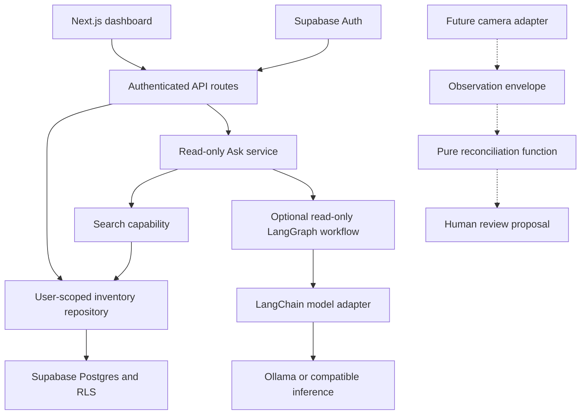

# Inventory

A private personal inventory MVP built with Next.js, Supabase Auth/Postgres, and an inventory AI assistant. Track possessions, consumables, locations, tags, condition, and stock. Search your items and ask where they are.

The project uses permissively licensed open-source libraries. Google ADK and Vercel AI SDK are not dependencies. The default costs **zero model calls**: Ask returns matching inventory records. Optional inference runs through a bounded LangGraph workflow with LangChain model adapters, using Ollama or another OpenAI-compatible server. Claude remains an explicit opt-in adapter. See [Technology and cost decisions](docs/technology.md).

## Try it immediately

Requires Node.js 22+ and npm.

```sh
nvm use # optional, if nvm is installed
npm ci
npm run dev
```

Open **http://localhost:3000**. The liquid-glass dashboard includes sample inventory, search, sorting, filters, reusable spaces, editable items, and nested containers. Click a container card to open its contents beside the grid; containers can be nested to create paths such as `Bedroom → Cabinet → Drawer → Camera`.

Without Supabase variables or an authenticated session, the dashboard uses clearly labeled sample data in memory. With both public Supabase variables configured and a valid session, it loads the account’s saved inventory and persists item, container, and location changes. `/demo` redirects to `/` so the same sample fallback is available for preview.

## Architecture, top down



1. **UI:** loads saved inventory when an authenticated Supabase session is available, falls back to labeled sample data otherwise, and renders cited answers from Ask.
2. **API:** verifies the Supabase user, checks same-origin writes, validates JSON, and returns consistent errors.
3. **Repository:** performs queries with that user's session. Database RLS independently enforces ownership.
4. **Ask:** retrieves bounded inventory facts, then lets Jarvis refine retrieval through a read-only `search_inventory` tool. The model sees facts and recent conversation, with no database client, auth token, or SQL tool. On explicit add/edit requests, tools prepare validated changes that the browser applies through the existing inventory store. Citations are validated against records actually retrieved in this request.
5. **Reconciliation:** turns a future observation into a review proposal. It cannot mutate inventory.

Follow the code in this order:

| Responsibility             | Entry point                                                |
| -------------------------- | ---------------------------------------------------------- |
| Prototype app entry        | `src/app/page.tsx`                                         |
| Dashboard and interactions | `src/components/liquid-dashboard.tsx`                      |
| Item validation and search | `src/lib/inventory.ts`                                     |
| API behavior               | `src/lib/handlers.ts`                                      |
| Verified request identity  | `src/lib/context.ts`                                       |
| Database queries           | `src/lib/repository.ts`                                    |
| Read-only answers          | `src/lib/ask.ts`                                           |
| Answer workflow            | `src/lib/answer-graph.ts`                                  |
| Model adapter              | `src/lib/provider.ts`                                      |
| Vision proposal boundary   | `src/lib/reconciliation.ts`                                |
| Tables and access policies | `supabase/migrations/` (apply SQL files in filename order) |

The original design and implementation checklist are in `docs/superpowers/`.

## Connect real accounts and storage

### Option A: Hosted Supabase

1. Create a Supabase project.
2. Open its SQL editor and apply all files in `supabase/migrations/` in filename order, including `202609170001_space_management.sql` for safe space deletion and moving contents. On an existing Inventory database, apply only migrations not already applied. Or use the CLI workflow below.
3. Copy `.env.example` to `.env.local` and populate `NEXT_PUBLIC_SUPABASE_URL` and `NEXT_PUBLIC_SUPABASE_PUBLISHABLE_KEY` from the project's API settings. A legacy anon key also works in the publishable-key variable. **Do not use a service-role or secret key.**
4. In **Authentication → URL Configuration**, set Site URL to `http://localhost:3000` for development. Add `http://localhost:3000/auth/confirm` to allowed redirects. Use the same hostname consistently, including `127.0.0.1` if you choose it.
5. With email confirmation enabled, edit the **Confirm signup** email template to use this link:

```html
<a href="{{ .SiteURL }}/auth/confirm?token_hash={{ .TokenHash }}&type=email"
  >Confirm your email</a
>
```

6. Restart `npm run dev` after configuration. Click **Sign in → Create an account**, confirm your email, and sign in. New accounts start with an empty inventory; create a place, then add your first item. Sign out returns to the sample inventory. Loading failures offer a retry without substituting samples. Supabase controls its password policy and Auth rate limits.

Confirmation redirects are fixed to the app root; arbitrary redirect URLs are not accepted. Password reset/social login are outside this MVP.

For repeatable CLI deployment, install the Supabase CLI using its [official instructions](https://supabase.com/docs/guides/local-development/cli/getting-started), then:

```sh
supabase login
supabase link --project-ref YOUR_PROJECT_REF
supabase db push
```

Do not apply this initial migration to an unrelated existing schema without reviewing its table names.

### Option B: Local Supabase

Install Docker and the Supabase CLI, then run from this directory:

```sh
supabase start
supabase status
```

The first start applies all migrations. Put the local API URL and anon/publishable key printed by `supabase status` in `.env.local`. The included local configuration disables email confirmation for development only. Later migration changes can be applied with `supabase migration up --local`. `supabase db reset` recreates the local database and deletes its data, so use it only for a disposable development database.

```sh
npm run dev
```

Supabase Studio: http://localhost:54323. The API and dashboard use Supabase for authenticated saved inventory; the embedded PGlite database is only used by automated migration tests.

## Private item photos

Signed-in users can upload JPG, PNG, or WebP photos up to 5 MB. Files go directly to the private `inventory-photos` Supabase bucket with an opaque, owner-specific path. The existing version-checked item update saves that path in `attributes.image_path`, so photos return after reloading or signing in on another device. Sample inventory keeps its photos in memory and labels them session-only.

Apply `supabase/migrations/202609160001_private_photos.sql` after the inventory and container migrations. It creates the private bucket, restricts file size/formats, and adds owner-only read/upload/delete policies. No extra environment variables or service-role key are required. Sign in through the dashboard to upload photos to your account.

The app checks ownership through `/api/items/:id/photo` and redirects to a 60-second signed URL. Treat a signed URL as temporary access to that image. Photo components bypass Next.js image optimization so authentication cookies reach the reader; the reader response is private and uncached. The stored item contains an object path, never an expiring URL. The upload pattern follows [Supabase Storage access control](https://supabase.com/docs/guides/storage/security/access-control) and [standard uploads](https://supabase.com/docs/guides/storage/uploads/standard-uploads).

A failed upload/save leaves the previous photo visible and reports that saving was not confirmed. Reload saved inventory after an ambiguous save failure. New objects never overwrite old objects. Replaced photos, uploads whose item save failed, and photos of deleted items are retained privately for now; automated cleanup is not implemented. Duplicated items can reference the same photo. When cleaning up the bucket through the Storage API or dashboard, remove only paths no item references, after a grace period for in-flight saves. Do not delete Storage metadata rows directly.

To verify a configured project, provide two different disposable confirmed accounts using `SMOKE_EMAIL`/`SMOKE_PASSWORD` and `SMOKE_OTHER_EMAIL`/`SMOKE_OTHER_PASSWORD` in `.env.local`, then run:

```sh
npm run test:photos
```

The smoke test uploads a synthetic one-pixel PNG, reloads its item/photo through a fresh session, replaces the photo, tests stale updates and cross-account/anonymous access, and cleans up its own test records and objects. It does not verify browser cookies: also upload a photo in the signed-in dashboard, reload, open it from a second device, and verify that a different account cannot open the original `/api/items/:id/photo` URL.

## Environment variables

| Variable                               | Requirement               | Purpose                                              |
| -------------------------------------- | ------------------------- | ---------------------------------------------------- |
| `NEXT_PUBLIC_SUPABASE_URL`             | Required for real storage | Supabase project API URL                             |
| `NEXT_PUBLIC_SUPABASE_PUBLISHABLE_KEY` | Required for real storage | Public browser key; RLS protects records             |
| `AI_PROVIDER`                          | Default `search`          | `search`, `google`, `openai-compatible`, or `claude` |
| `AI_BASE_URL`                          | Compatible inference      | Server-only URL ending in `/v1`                      |
| `AI_MODEL`                             | Compatible inference      | Exact installed/hosted model ID                      |
| `AI_API_KEY`                           | Optional                  | Server-only compatible provider key                  |
| `ANTHROPIC_API_KEY`                    | Only for Claude           | Server-only hosted API key                           |
| `ANTHROPIC_MODEL`                      | Only for Claude           | Exact model ID available to your account             |
| `SMOKE_EMAIL`, `SMOKE_PASSWORD`        | Integration test only     | Disposable confirmed account                         |

Keep `.env.local` out of version control. No service-role credentials are needed.

## Optional open-source inference

Install [Ollama](https://ollama.com/) and start its local service. The documented model, [Qwen3-8B](https://huggingface.co/Qwen/Qwen3-8B), uses Apache-2.0; model licenses vary, so check the exact model you substitute.

```sh
ollama pull qwen3:8b
```

Set these values, keeping the Supabase variables:

```dotenv
AI_PROVIDER=openai-compatible
AI_BASE_URL=http://127.0.0.1:11434/v1
AI_MODEL=qwen3:8b
AI_API_KEY=
```

Restart Next.js. Jarvis runs a LangGraph generate → search → generate loop through LangChain. The model expands the user's intent into inventory searches, then returns a cited answer. The `/no_think` instruction requests Qwen's non-thinking mode. The configured model must support tool calling. Unavailable models, timeouts, and invalid answers produce labeled search results.

Cost controls: at most four model turns, four tool calls per turn (at most twelve executed searches), no model retries, 1,200 output tokens per generation, and a 25-second graph deadline. Each retrieval returns at most 20 facts within 12,000 characters; full descriptions (up to 2,000 characters) are retained so edits cannot lose unseen notes; large attributes are omitted. The compatible and Claude adapters additionally have a 20-second call timeout. Questions are limited to 1,000 characters and history to the last six exchanges. There is no automatic provider failover or vector database.

### Local Jarvis demo

Run `npm run dev` and open the dashboard. Without Supabase, each chat request sends the current session's inventory snapshot to `/api/ask/local`, including item edits, explicit locations and container breadcrumbs. This endpoint is same-origin, development-only, bounded to 5,000 records, 1,000 locations and an 8 MB body; excessive requests fail explicitly rather than silently dropping inventory. It does not write or persist inventory. Local sample inventory and chat reset on reload. With a saved Supabase session, `/api/ask` uses the authenticated repository and the same retrieval/answer contract.

Try “Pack me for camping,” “What can I use to take pictures?” and “Show my camera accessories.” The sample includes a camera, tripod, and SD card. Ask follow-ups such as “Where are those?” or “Remove the camera from that list.” Click a result to open its item details. Camping answers distinguish usable possessions from suggested essentials; product suitability and accessory compatibility still need checking.

Jarvis can also create and edit inventory records. Try “Add a tent in College, category Camping,” “Rename my backpack to Hiking backpack,” or “Tag my camera with travel.” It can edit name, description, category, tags, quantity/unit, status, condition, and placement in an existing place or uniquely named container. It does not expose deletion or ownership changes. Durable items retain quantity 1; stock counts use consumables.

Add/edit tools prepare at most five changes per request. The UI validates the complete batch and checks item versions before applying changes through the normal store. Only successfully applied records receive an “Added” or “Updated” confirmation. Saved inventory still uses the authenticated CRUD API with database ownership and version checks. If a save fails partway through a batch, the response identifies completed changes and reports that the remaining changes were not applied; it does not automatically retry. Packing-list suggestions and revisions do not mutate inventory. Model-disabled search cannot add/edit items.

For Gemini, use the native Google adapter so tool-call thought signatures are preserved:

```dotenv
AI_PROVIDER=google
AI_MODEL=gemini-3.5-flash-lite
AI_API_KEY=your-google-ai-studio-key
```

`AI_BASE_URL` is ignored by the native Google adapter. Keys remain server-only. Local inventory means the records live in this browser session; with hosted inference, retrieved item facts and recent chat are sent to that configured provider. Choose Ollama to keep inference local too. The default `AI_PROVIDER=search` uses a small deterministic fallback for camping, photography, and accessories, and does not understand conversational follow-ups.

An optional live integration test sends only a fabricated camera fixture to the configured provider:

```sh
JARVIS_LIVE_TEST=1 node --env-file=.env.local node_modules/vitest/vitest.mjs run tests/jarvis-live.test.ts
```

Normal `npm test` skips this test and makes no model calls. The native adapter follows [LangChain's Google integration](https://docs.langchain.com/oss/javascript/integrations/chat/google).

To opt into Claude, set `AI_PROVIDER=claude`, `ANTHROPIC_API_KEY`, and `ANTHROPIC_MODEL`. The same validated search and item-change contract applies. Provider errors or invalid/unknown citations produce a labeled search fallback. Model prose can still be wrong even with valid citations; the UI offers source records to verify facts.

## Schema and domain rules

- `items`: one durable possession per row (`quantity = 1`) or a consumable stock with nonnegative decimal quantity and a unit. Durable rows have no reorder threshold. For a spool or battery, use a durable row with flexible remaining-capacity attributes, or a consumable row measured in grams/units, depending on what you track.
- `container` items are durable folder-like records. A root container belongs to a reusable location; a nested item or container belongs to one parent container. Its effective location and breadcrumb path are derived from the root, so moving a parent moves the visible subtree without rewriting every child.
- Container cycles, cross-owner parents, non-container parents, occupied-container type changes, and deletion of non-empty containers are rejected by both the application and the database migration.
- `locations`: owner-specific Spaces and optional Rooms in the same table. A Space has no parent; a Room belongs to exactly one root Space. Existing locations remain Spaces until explicitly created as Rooms. Names are unique among siblings, so `Home → Bedroom` and `Cabin → Bedroom` may coexist. Owner-matching foreign keys protect item placement and room parents.
- Creation starts as a browser draft and writes only when Add submits a valid name and placement. The client keeps one `X-Inventory-Request-Id` UUID per draft; explicit retries with the same key return the same record rather than creating duplicates. A failed response can be uncertain: retain the draft/key and reload saved inventory before retrying. A confirmed insert still returns success if only its subsequent hierarchy read fails.
- `inventory_observations`: append-only source events with confidence, event identity, observed/received times, base version, and proposed patch. Unique `(user_id, source, source_event_id)` prevents duplicate events. Owner-matching references prevent foreign item observations.
- `inventory_activity`: owner-scoped audit events created by database triggers for item creation, edits, moves, and deletion. Events capture the owning room, item name, action channel (`user` or `jarvis`), and time at which the mutation occurred. The dashboard does not invent history for records that predate this migration.
- `inventory_dashboard_visits`: the last dashboard briefing that the user explicitly acknowledged after it rendered. “Since your last visit” is used only when this durable marker exists; first visits show activity recorded in the past 30 days.
- Tags are normalized lowercase arrays. Attributes are bounded JSON objects. Status: `active`, `stored`, `lent`, `disposed`. Condition: `new`, `good`, `fair`, `poor`, `unknown`.
- Updates increment `version` in Postgres. Edit/delete requests include the version they read; stale operations return `409`.
- Deletion is permanent and removes associated observations. Use `disposed` to retain an inventory entry and its history.
- Listing returns at most 200 records per search. A connected UI must make this limit visible; refine the query for larger inventories. Filters/statistics apply to the current result set. Search uses parameterized literal terms, with OR matching across names, notes, categories, locations, tags and attributes.

## API

Every production route requires the verified Supabase session cookie. Write requests also require an `Origin` matching the request URL and JSON content type. Request bodies are bounded to 16 KB.

| Method | Route                     | Input / result                                                                         |
| ------ | ------------------------- | -------------------------------------------------------------------------------------- |
| GET    | `/api/items?q=charger`    | `{ items, limit: 200 }`                                                                |
| POST   | `/api/items`              | Item fields → `{ item }`, 201                                                          |
| PUT    | `/api/items/:id`          | Full editable item fields plus `version` → `{ item }`                                  |
| DELETE | `/api/items/:id`          | `{ version }` → `{ deleted: true }`                                                    |
| GET    | `/api/locations`          | `{ locations }`                                                                        |
| POST   | `/api/locations`          | `{ name }` → `{ location }`, 201                                                       |
| POST   | `/api/ask`                | `{ question }` → `{ answer, citations, mode, notice? }`                                |
| GET    | `/api/dashboard`          | Per-user activity groups, summary, and grounded suggestion                             |
| POST   | `/api/dashboard/visit`    | `{ asOf }` → `{ acknowledged: true }`                                                  |
| GET    | `/api/inventory/contents` | `type=location\|container\|all`, scope `id`, optional `offset` → structured scope page |

Apply `202610130001_rooms_creation.sql` after the existing migrations before deploying this application version. It adds room hierarchy, location versions, sibling name indexes, and idempotent creation RPCs. It preserves existing root locations and inventory; it does not infer room parents from names. A root Space with Rooms cannot be deleted until its Rooms have been removed.

Jarvis uses the complete current account snapshot for its bounded overview/search tools, with one shared snapshot per request. Exact location/container questions such as “Show everything in Home” use structured results independently of the model: a Space includes its direct items, all Rooms, and nested container contents; a container scope includes all descendants. Duplicate names require a full path. Scope pages contain at most 100 records within a 240 KB UTF-8 record budget and report `total`, `offset`, `nextOffset`, and `complete`; load subsequent pages instead of treating model citations as a full list. Send the returned `revision` when continuing; matching inventory or path changes produce a `409` so the query can restart with current records. Model context remains limited to 20 full facts/12,000 characters per retrieval and a compact paged overview. Packing fallbacks use available owned records and label general essentials as checks rather than possessions.

The dashboard endpoints require the same verified session as inventory CRUD. After a dashboard response renders successfully, acknowledge its exact `asOf` value; do not acknowledge loading or failed responses. Suggestions are deterministic and appear only when current items in the same non-empty category span at least two owning spaces. Opening a suggestion starts a read-only Jarvis planning conversation and does not mutate inventory.

Ordinary mutations are attributed to the signed-in user. The existing item mutation routes accept `X-Inventory-Actor: jarvis` only for changes explicitly prepared and applied through Jarvis; absent headers default to `user`, and other values are rejected. Attribution identifies the application action channel, not a separate security principal.

Ownership fields are never accepted from callers. Error responses use `{ error }`: 400 invalid input, 401 missing auth, 403 forbidden/origin mismatch, 404 unknown/foreign item, 409 stale/conflicting data, 413 excessive body, 415 non-JSON body, 503 missing setup/storage unavailable. All personalized responses use `private, no-store`.

## Future camera integration

A vision adapter should identify a candidate item and produce an observation envelope. Example:

```json
{
  "user_id": "11111111-1111-4111-8111-111111111111",
  "item_id": "22222222-2222-4222-8222-222222222222",
  "source": "camera",
  "source_event_id": "camera-session-12:event-57",
  "confidence": 0.94,
  "observed_at": "2026-09-13T12:00:00Z",
  "base_version": 3,
  "proposed_patch": { "status": "stored" }
}
```

Call `reconcile(item, observation)`. It validates identity and proposed quantities, checks version and time, and returns `decision: "review"` with `confirmation_required`, `low_confidence`, `version_conflict`, or `stale_observation`. It never writes, even at confidence 1.0. A future authenticated ingestion route must derive `user_id` from the session, check destination ownership, deduplicate, persist the event, and expose explicit human confirmation through a version-checked writer. There is no ingestion or confirmation route yet. Observations are evidence; item fields are the current manually confirmed state.

## Tests and verification

```sh
npm run release:check # formatting + lint + TypeScript + tests + production build
# Or run checks separately:
npm run check       # lint + TypeScript + core/HTTP/provider/Postgres tests
npm run build       # production compilation and route generation
npm run format:check
```

The database suite runs the real migration in **PGlite**, an embedded PostgreSQL engine, with two users, `auth.uid()` and authenticated/anonymous role fixtures. It executes RLS, quantity constraints, owner-matching foreign keys, stale updates, RPC search, append-only observation access and deduplication. It does not replace testing Supabase Auth/PostgREST in a configured project.

For a real integration smoke test, create a disposable confirmed Supabase user and set `SMOKE_EMAIL`/`SMOKE_PASSWORD` in `.env.local`:

```sh
npm run test:supabase
```

This script signs in through real Auth, creates its own temporary location/item, checks RPC search and stale update behavior, then deletes only those test records and signs out. It does not use admin credentials or print credentials. See `docs/verification.md` for checks performed during delivery and external dependencies still needing configuration.

## Deploy to Vercel

1. Import the existing `PaperTop/inventory` GitHub repository into Vercel. Use the repository root (`.`) as Root Directory.
2. Choose Next.js and Node 22.x. Install: `npm ci`; build: `npm run build`. No custom output directory is needed.
3. Set the two public Supabase variables in the intended Vercel environments. Keep `AI_PROVIDER=search` initially.
4. Apply all pending migrations to that environment's Supabase database before first use.
5. Set Supabase Site URL to the deployed HTTPS URL and allow its `/auth/confirm` URL. Configure preview redirect URLs intentionally; use a separate Supabase development project for previews.
6. Deploy. Test account creation/confirmation, login/logout, CRUD, search, and two-user isolation. CI runs lint/typecheck/tests/build on pushes and pull requests.
7. To enable inference on Vercel, use a secured, remotely reachable compatible endpoint or the opt-in Claude adapter. **Vercel cannot reach Ollama running on your laptop at localhost.** Keep API keys server-only. The Ask route declares a 30-second maximum, with a 20-second provider timeout.

The app can also run on a regular Node server with `npm run build` and `npm start`; it has no required Vercel-only APIs. When exposing a paid model publicly, add shared per-user rate limits/quotas and provider spend limits first. This MVP bounds each request but does not impose a shared daily spending quota. Hosted Supabase, Vercel and hosted model services have their own service plans and terms; permissive source licenses do not imply free infrastructure.
