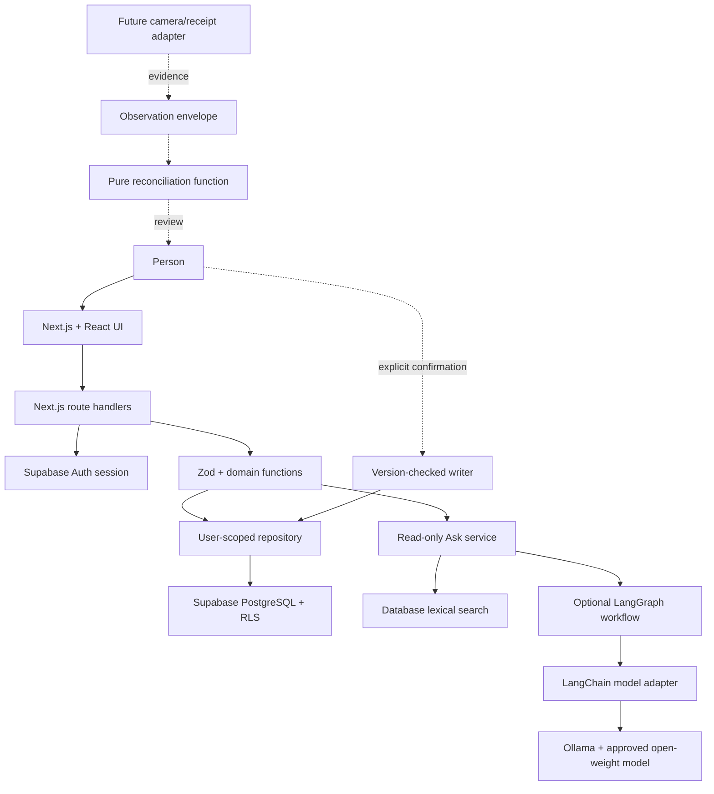

# Inventory project planning guide

This document is the top-down map for Inventory. It explains the product, every major subsystem, the tool used by each subsystem, the boundaries between them, and the order in which to build the next versions.

The canonical project is currently at `/Users/jadenhuang/Inventory`. This guide should live in the project's `planning/` directory and stay current as architecture decisions change.

## Photo storage update — 2026-09-16

Private photo upload/read support is implemented for saved inventory. Apply all three migrations, including `202609160001_private_photos.sql`. Supabase configuration and a signed-in session are still required for persistent uploads; sample photos remain session-only. See the README’s private-photo setup, retention policy, and hosted smoke test. Hosted verification is pending.

## 1. Product definition

Inventory is a private, user-owned record of physical belongings. A person can add things manually, organize them by location and tags, track consumable quantities, search the collection, and ask a read-only assistant questions about what is already theirs.

The product has one source of truth: the manually confirmed inventory database. AI output, camera detections, receipts, and suggestions are evidence. Evidence can propose a change, but never silently changes the source of truth.

### MVP success criteria

- A person can create an account and sign in.
- A person can create, edit, search, and delete inventory entries.
- Durable items and consumables have different quantity rules.
- Locations, tags, status, condition, and flexible attributes are supported.
- One user's data is invisible and inaccessible to another user.
- Ask returns matching inventory records and citations without model access by default.
- An optional local model can summarize bounded search results.
- Future camera events have a typed path to review proposals, but no automatic writes.
- The project can run locally and deploy to Vercel with Supabase.

### Deliberately deferred

Receipt ingestion, camera capture, object detection, embeddings, semantic search, sharing, price tracking, purchase automation, notifications, mobile apps, and autonomous writes are later projects. They should only be added after the manual inventory loop is useful and measured.

## 2. System at a glance



### Request flow

1. The browser sends a request to a Next.js route.
2. The server validates the Supabase session and derives the user ID.
3. The route validates the body with Zod and applies the same-origin check to writes.
4. The repository queries Supabase with the user's session.
5. PostgreSQL RLS independently applies the ownership rule.
6. The response is private and uncached.

### Ask flow

1. The user submits a question.
2. The Ask service rejects mutation language such as delete, add, move, or consume.
3. The repository performs bounded lexical retrieval.
4. By default, the service returns a deterministic record-based answer.
5. If configured, a LangGraph node passes only the bounded facts to a LangChain model adapter.
6. The model must return JSON containing an answer and existing item IDs.
7. Unknown citations or malformed output are rejected and the deterministic result is shown.

### Observation flow for a future release

1. A camera or receipt adapter creates an observation with source, event ID, confidence, time, item ID, base version, and proposed patch.
2. The reconciliation function checks owner, item identity, quantity rules, confidence, time, and version.
3. It returns a review proposal with a reason such as `low_confidence` or `version_conflict`.
4. The UI shows the proposal to the person.
5. Only an explicit confirmation calls a version-checked writer.

## 3. Technology choices

| Part               | Current choice                     | What it does                                              | Why this choice                                               |
| ------------------ | ---------------------------------- | --------------------------------------------------------- | ------------------------------------------------------------- |
| Web framework      | Next.js App Router                 | Pages, server rendering, route handlers                   | One TypeScript deployment with clear server/client boundaries |
| UI                 | React + TypeScript                 | Interactive dashboard and forms                           | Familiar component model and strong type checking             |
| Styling            | Plain CSS                          | Responsive visual system                                  | Low dependency count and easy customization                   |
| Authentication     | Supabase Auth + `@supabase/ssr`    | Password auth and verified cookie sessions                | Managed auth with a standard Next.js server integration       |
| Database           | Supabase PostgreSQL                | Inventory, locations, observations, indexes, constraints  | Durable relational source of truth with RLS                   |
| Validation         | Zod                                | Shared input and output contracts                         | Stops malformed data at API and domain boundaries             |
| API                | Next.js Route Handlers             | Authenticated CRUD, locations, and Ask endpoints          | Keeps authorization close to data access                      |
| Orchestration      | LangGraph                          | Read-only Ask workflow now; stateful reconciliation later | Explicit state, persistence, pause, and human approval        |
| Model integrations | LangChain components               | Model-neutral adapters inside graph nodes                 | Swap Ollama, hosted compatible endpoints, or Claude           |
| Local inference    | Ollama                             | Local OpenAI-compatible model server                      | No per-token billing during development                       |
| Recommended model  | Qwen3-8B or another reviewed model | Optional summarization                                    | Good small-model starting point; verify exact model license   |
| Tests              | Vitest + PGlite                    | Domain, HTTP, model boundary, and RLS tests               | Fast feedback and real PostgreSQL policy behavior             |
| Hosting            | Vercel + Supabase                  | Web deployment and managed database                       | Low operations overhead for an MVP                            |

LangGraph and LangChain do not replace ordinary application code. Database search, validation, ownership, and writes remain deterministic. The graph orchestrates the optional answer generation step.

## 4. Frontend plan

### Pages

| Page            | Purpose                                 | Access                     |
| --------------- | --------------------------------------- | -------------------------- |
| `/`             | Liquid-glass dashboard with sample data | Public visual prototype    |
| `/demo`         | Redirect to the main dashboard          | Public compatibility route |
| `/auth/confirm` | Verify an email token and return home   | Public callback            |

### Dashboard responsibilities

`src/components/liquid-dashboard.tsx` owns the current visual prototype and browser interaction state:

- Present the local dummy inventory and locations.
- Search, sort, and filter the visible items.
- Select, edit, move, duplicate, and delete local items.
- Present responsive desktop, tablet, and mobile layouts.
- Keep the UI boundary ready for the later Supabase and account connection.

The dashboard must not contain SQL, Supabase service keys, or ownership decisions. Existing repository, API, and authentication groundwork remains separate for later integration.

### UI behavior rules

- Make privacy visible: “Private to you.”
- Label demo data as temporary.
- Label deterministic Ask as “Inventory search · no AI model.”
- Label model output as AI-generated and show citations.
- Tell the person when the result is empty rather than implying non-ownership.
- Keep delete explicit; use `disposed` when history should be retained.
- Preserve the current editor state when background refreshes finish out of order.

## 5. Authentication and security

### Trust boundaries

1. Browser input is untrusted.
2. Model output is untrusted.
3. Camera observations are untrusted.
4. Supabase Auth claims are verified server-side.
5. PostgreSQL RLS is the final database ownership boundary.

### Rules

- The browser never submits an authoritative `user_id`.
- The server calls Supabase Auth verification and derives the user ID.
- Every table has `user_id` and RLS policies.
- Item-to-location references use a composite `(user_id, location_id)` foreign key.
- Observation-to-item references use a composite owner-matching foreign key.
- Anonymous roles have no application table access.
- Application runtime never uses a service-role key.
- Writes require a same-origin `Origin` header.
- JSON bodies are bounded to 16 KB.
- Personalized responses use `Cache-Control: private, no-store` and `Vary: Cookie`.
- Model requests contain no auth cookies, user IDs beyond citations, SQL, or writer functions.
- Provider requests have no automatic retries, one generation, bounded output, and a timeout.

### Error mapping

| Situation                           | Response |
| ----------------------------------- | -------- |
| Invalid body                        | 400      |
| Missing session                     | 401      |
| Cross-origin write                  | 403      |
| Unknown or foreign item             | 404      |
| Stale version                       | 409      |
| Oversized body                      | 413      |
| Wrong content type                  | 415      |
| Missing Supabase or storage failure | 503      |

## 6. Database and data model

### `locations`

Reusable named places owned by one user. Names are unique per user case-insensitively. Deleting a location is restricted by item references in the current schema; move items first.

### `items`

| Field                       | Meaning                                                           |
| --------------------------- | ----------------------------------------------------------------- |
| `id`                        | Stable UUID                                                       |
| `user_id`                   | Owner, derived from Auth                                          |
| `name`                      | Human-readable item name                                          |
| `kind`                      | `durable` or `consumable`                                         |
| `description`               | Notes                                                             |
| `category`                  | Broad grouping                                                    |
| `quantity`                  | `1` for durable; nonnegative decimal for consumable               |
| `unit`                      | `item`, `bottle`, `kg`, `grams`, etc.                             |
| `reorder_threshold`         | Optional consumable low-stock level                               |
| `location_id`               | Owner-matching location reference                                 |
| `tags`                      | Lowercase text array                                              |
| `status`                    | `active`, `stored`, `lent`, `lost`, or `disposed`                 |
| `condition`                 | `new`, `good`, `fair`, `poor`, or `unknown`                       |
| `attributes`                | Bounded JSON object for model, color, expiry, and similar details |
| `version`                   | Optimistic concurrency number                                     |
| `created_at` / `updated_at` | Audit and ordering timestamps                                     |

### `inventory_observations`

Append-only evidence records contain `source`, `source_event_id`, `confidence`, `observed_at`, `received_at`, `base_version`, and `proposed_patch`. A unique owner/source/event key prevents duplicate processing. An observation never updates an item directly.

### Database enforcement

- Check constraints repeat quantity and enum validation outside the application.
- A trigger increments `version` and timestamps every update.
- RLS policies restrict select, insert, update, and delete by `auth.uid()`.
- The search RPC is invoker-rights, so RLS still applies.
- GIN indexes support tags; owner/date and owner/location indexes support common views.

## 7. API and domain layer

### Routes

| Method | Path             | Behavior                                           |
| ------ | ---------------- | -------------------------------------------------- |
| GET    | `/api/items?q=`  | Search up to 200 owned records                     |
| POST   | `/api/items`     | Create an item                                     |
| PUT    | `/api/items/:id` | Replace editable fields when `version` matches     |
| DELETE | `/api/items/:id` | Permanently delete when `version` matches          |
| GET    | `/api/locations` | List owned locations                               |
| POST   | `/api/locations` | Create an owned location                           |
| POST   | `/api/ask`       | Read-only retrieval and optional answer generation |

### Domain modules

`inventory.ts` defines enums, strict Zod inputs, normalized tags, low-stock logic, lexical ranking, and item types.

`ask.ts` defines the `InventoryReader` and `AnswerProvider` interfaces. It retrieves records, strips oversized fields, refuses mutation-shaped questions, validates model JSON, filters citations to retrieved IDs, and falls back to deterministic search.

`reconciliation.ts` defines the observation contract and a pure `reconcile(item, observation)` function. It returns a proposal; it does not import Supabase or a writer.

`repository.ts` is the only application module that knows Supabase table names. It maps database errors to HTTP-safe errors and applies owner/version filters to mutations.

`handlers.ts` owns HTTP parsing and error mapping. Route files remain thin wrappers around authenticated context creation and handlers.

### Search behavior

Search is database-first and lexical. Terms match names, descriptions, categories, locations, tags, and JSON attributes. Name matches rank ahead of general text matches. Search is parameterized and bounded; it does not execute user-provided SQL.

## 8. AI and LangGraph plan

### Why LangGraph

The long-term Inventory loop is stateful:

`capture → identify → reconcile → enrich → reason → review → confirm → learn`

LangGraph is appropriate when those steps need persisted state, resumable failures, human approval, or different branches for uncertain evidence. Its persistence layer supports checkpoints and human-in-the-loop pauses. LangChain provides the model abstractions used inside nodes.

### V1 graph

The first graph should remain deliberately small:

```text
START
  ↓
retrieve_owned_items
  ↓
optional_model_summary
  ↓
validate_citations
  ↓
END
```

There are no write tools, no SQL tools, no web tools, no purchase tools, and no autonomous loops. The graph receives a question and a bounded fact snapshot. It returns a validated answer object.

### Future reconciliation graph

```text
START
  ↓
capture_observation
  ↓
match_candidate_to_inventory
  ↓
reconcile_against_version
  ├─ low confidence → review
  ├─ stale version → review/conflict
  ├─ no candidate → unresolved
  └─ high confidence → review
  ↓
human confirmation interrupt
  ├─ reject → record rejection → END
  ├─ edit → validate edited patch → confirm again
  └─ accept → version-checked writer → END
```

Use a persistent Postgres checkpointer when this graph becomes real. Use an in-memory checkpointer only for tests and prototypes. Keep the writer outside model control and behind a human-approved command.

### Cost controls

- Search first; do not call a model for exact lookups.
- One generation per question.
- Maximum 1,200 output tokens.
- 20-second timeout.
- No retries.
- At most 20 records and a 12,000-character fact budget.
- Descriptions truncated to 500 characters; large attributes omitted.
- Default provider is deterministic search.
- Local Ollama avoids per-token vendor billing during development.
- Add per-user quotas before enabling hosted models publicly.

## 9. Camera and vision extension

Camera code should be a separate adapter. It may use object detection, tracking, segmentation, OCR, or speech, but those tools produce observations—not direct database writes.

```ts
type Observation = {
  user_id: string;
  item_id: string;
  source: "camera" | "receipt" | "manual";
  source_event_id: string;
  confidence: number;
  observed_at: string;
  base_version: number;
  proposed_patch: {
    location_id?: string | null;
    quantity?: number;
    status?: "active" | "stored" | "lent" | "lost" | "disposed";
  };
};
```

The adapter should preserve raw evidence references and timestamps. Reconciliation checks identity and ownership, rejects negative quantities, marks stale/low-confidence observations, and returns a review reason. A future route must derive `user_id` from Auth, deduplicate event IDs, persist the observation, and never accept a caller-supplied owner.

## 10. Testing strategy

### Domain tests

Test strict validation, durable/consumable quantity rules, tag normalization, low-stock detection, lexical ranking, empty retrieval, citation filtering, model fallback, and reconciliation conflicts.

### HTTP tests

Test missing authentication, cross-origin writes, malformed JSON, body limits, invalid UUIDs, CRUD behavior, stale versions, and read-only Ask behavior using an in-memory repository.

### Database tests

Run the real migration in PGlite with two users and `auth.uid()` fixtures. Test:

- Foreign rows are hidden.
- Owner spoofing is blocked.
- Foreign location references fail.
- Stale updates change zero rows.
- Quantity checks hold outside TypeScript.
- Search RPC remains owner-scoped.
- Observations are deduplicated and append-only.
- Anonymous reads are denied.

### Provider tests

Test that the LangChain adapter is disabled by default, receives no tools, performs one bounded call, validates structured JSON, and does not retry a failed provider request.

### Browser smoke

Use `/` to verify the rendered liquid-glass dashboard, search and filter items, change locations, edit an item, duplicate it, and delete it. Use a configured Supabase project for account and RLS smoke tests after connecting the prototype to the backend.

## 11. Local setup and deployment

### Local demo

```sh
cd /Users/jadenhuang/Inventory
npm ci
npm run dev
```

Open `http://localhost:3000`.

### Supabase setup

1. Create or start a Supabase project.
2. Apply `supabase/migrations/202609130001_inventory.sql`.
3. Copy `.env.example` to `.env.local`.
4. Set the public Supabase URL and publishable key.
5. Configure the Auth site URL and `/auth/confirm` redirect.
6. Run the app and create an account.

Never add a service-role key to browser or Vercel client variables.

### Optional local model

```sh
ollama pull qwen3:8b
```

```dotenv
AI_PROVIDER=openai-compatible
AI_BASE_URL=http://127.0.0.1:11434/v1
AI_MODEL=qwen3:8b
AI_API_KEY=
```

The exact model license must be checked before commercial distribution. The app does not download or bundle model weights.

### Vercel

Import the project with root directory `/Users/jadenhuang/Inventory` in your local checkout. Use Node 22, `npm ci`, and `npm run build`. Apply the migration before first use. Set Supabase redirect URLs for the deployed HTTPS domain. Vercel cannot reach Ollama on a laptop; use a secured compatible endpoint or leave `AI_PROVIDER=search`.

## 12. Build roadmap

### Phase 0 — Understand and run

- Run the demo.
- Read this folder and the existing `docs/superpowers` design.
- Trace one item from form to route to repository to database.
- Trace one Ask question through search and citation rendering.

### Phase 1 — Harden the MVP

- Configure a real Supabase project.
- Run the real Auth/PostgREST smoke script.
- Add rate limits and audit logging for hosted inference.
- Improve location deletion behavior and data export.
- Add accessibility and mobile browser checks.

### Phase 2 — LangGraph Ask workflow (implemented)

- `@langchain/langgraph` and `@langchain/core` provide graph state and execution.
- LangChain model adapters connect compatible endpoints and optional Claude.
- The Ask flow has a bounded state schema and one read-only generation node.
- Graph tests use deterministic model doubles and reject malformed output.
- Persistent checkpoints remain deferred until conversations or review pauses require them.

### Phase 3 — Observation review

- Add observation ingestion behind Auth.
- Store raw event metadata and deduplicate source event IDs.
- Build a review queue with accept, edit, reject, and conflict states.
- Add a version-checked explicit writer node after confirmation.
- Instrument false matches and rejected proposals before adding autonomy.

### Phase 4 — Vision and semantic retrieval

- Evaluate detection/tracking models against the user's actual environments.
- Add embeddings only when lexical search misses measured queries.
- Keep the relational item record and RLS as the authority.
- Reassess model and infrastructure cost from real usage.

## 13. Decision log

- **Supabase over a custom auth/database service:** fewer moving parts and database-enforced ownership.
- **Database search before AI:** cheaper, predictable, and better for exact inventory questions.
- **No Google ADK:** it adds an orchestration dependency that is not needed for this MVP.
- **LangGraph over a generic agent loop:** future camera reconciliation needs explicit state and human approval.
- **LangChain inside graph nodes:** standard model interfaces without giving the model database access.
- **Ollama as local default:** development inference without per-token billing.
- **Qwen3-8B as a starting model:** small enough to explore locally; verify the exact weight license and hardware fit.
- **Observation proposals instead of automatic updates:** protects the user's manually confirmed state from perception errors.
- **Optimistic versions:** prevents an old editor or delayed observation from overwriting newer truth.
